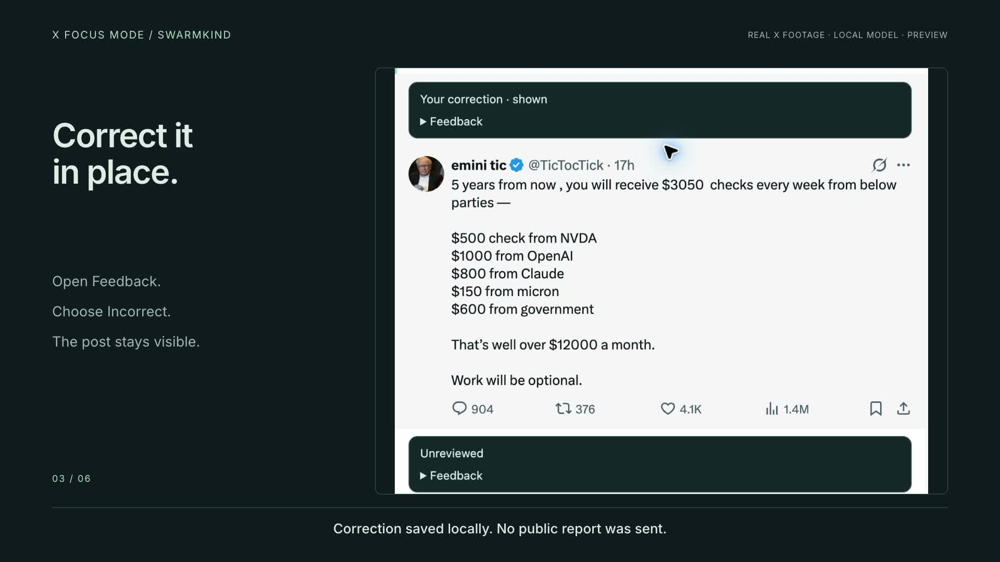

# X Focus Mode

**Your attention, your rules.** A small, open-source Chrome extension that adds personal filters and inspectable community warnings to X.

> **Developer preview.** v0.1.5 replaces per-post banners with an action-row 👎 menu and floating Reveal control. Its compact layout is browser-tested. Live v0.1.4 rejection, Reveal and correction preserved a 178 px post; v0.1.5 makes the circular accent uniform. v0.1.2 was tested on the logged-in X home feed with local Ollama, including Reveal and correction. The real-tweet demo deliberately shows a model mistake. Automated tests use fictional feed data and a scripted model. Classifier quality, provider OAuth, 8 GB hardware and connectivity across separate networks remain release gates. There is no public Swarmkind relay or Chrome Web Store listing yet.

**Previous interface:** the video below shows v0.1.2.

[](https://github.com/swarmkind/x-focus-mode/releases/download/v0.1.2/x-focus-mode-0.1.2-demo.mp4)

Built by [@swarmkind](https://x.com/swarmkind). Start with the [illustrated guides](assets/README.md) and [Quick start](docs/QUICKSTART.md).

## What it does

- Blur, colour or ignore **ragebait**, **doomering**, **engagement farming** and **suspected AI slop**. These are content judgements, not proof of authorship or intent.
- Reveal immediately. Revealing never counts as agreeing with a label.
- Highlight posts matching interests you specify. Preferences and corrections stay out of shared reports.
- Use **your OpenRouter account**, an API key for an HTTPS OpenAI-compatible chat endpoint, **local Ollama**, or **community flags only**.
- Share small, signed warnings and distribute bounded portions of the report cache through native WebRTC. Human reports and model assessments remain visibly distinct.
- Keep community auto-blur off unless you enable it. A signature identifies a pseudonymous publisher; it does not establish truth or unique human identity.

## Install the preview

1. Download the extension ZIP from [Releases](https://github.com/swarmkind/x-focus-mode/releases) and extract it.
2. Open `chrome://extensions`, enable **Developer mode**, select **Load unpacked**, and choose the extracted directory containing `manifest.json`.
3. Open the extension's settings. Choose a reviewer, model and category actions.
4. For community features, enter a compatible relay you run or trust. The preview does not silently connect to a public relay.
5. Read the data disclosure, select sharing/distribution independently, accept it, and save. Reload X after installing.

**Updating an unpacked copy:** replace its files, click **Reload** on its card in `chrome://extensions`, then reload X. Reloading the X tab alone can leave the old extension scripts installed.

API credits are paid to your chosen provider. An API key is not a consumer chat subscription. OpenRouter sign-in creates a provider key through OAuth PKCE. Local mode needs an existing Ollama installation: [setup guide](docs/OLLAMA.md).

## Privacy, in plain language

Before consent, the extension makes no provider or community requests. API mode sends eligible public post text and your interests directly to your provider. Ollama mode sends text to a loopback endpoint on your machine. Community mode makes no model calls.

Shared reports contain **tweet ID, category codes, human/model source, model name, pseudonymous public key, signature, revision and expiry**. They contain no tweet text, free-form explanation, X handle, API key, personal interest or reveal history. New contributions come only from home-feed posts whose public visibility and ownership can be established. Your own posts, protected posts, DMs, profiles, bookmarks and X block lists are excluded. Uncertain visibility stays local; remote AI also abstains in that case.

The signing key links your reports. A relay sees requested tweet IDs and connection IPs. WebRTC peers can learn your public IP and requested IDs. Infrastructure security logs may exist even though our application does not log request bodies. Distributed copies cannot be recalled. Read the complete [privacy policy](docs/PRIVACY.md) and [security limitations](SECURITY.md).

## A bounded hybrid network

The Cloudflare Worker/D1 relay bootstraps discovery and serves misses. A hibernating Durable Object exchanges WebRTC connection messages. Each consenting participant seeds portions of two of 64 hash buckets, with at most four peers, a 20 MB report cache, and daily 10 MB upload / 10 MB background download budgets. Transfers can continue with X closed while Chrome runs. Turn distribution off to close the offscreen document and connections.

Cache → peers (300 ms deadline) → primary relay. Positive peer results may be stale; primary refresh is bounded to a 30-minute window during continued use. Empty peer responses do not prove absence. Buckets sync incrementally. Withdrawals supersede earlier reports; expired data is ignored and removed. There is no paid TURN dependency. Direct peer connectivity can fail behind restrictive networks; HTTPS lookup remains available.

The relay retains records for at most 30 days, admits at most 16 publishers per tweet and 60,000 total records, and fails closed when capacity is exhausted. This is an initial bootstrap network, not a global DHT or a promise of unlimited free service. See [deployment and costs](docs/DEPLOYMENT.md).

## Develop

Node 24+ and npm. Runtime dependencies: **none in the extension**.

```sh
npm ci
npm run check
npm test
npm run build
```

Load `dist/` unpacked. To run the local relay:

```sh
npx wrangler d1 execute x-focus-mode --local --file=relay/schema.sql
npm run dev:relay
```

In another terminal:

```sh
npx playwright install chromium
npm run test:relay
npm run test:browser
```

**Browser tests delete only the local emulator's report table.** Run them against disposable development state. The test build enables a loopback fixture origin; that permission and fixture code are excluded from the release build. Set `CHROME_PATH` to a Chrome for Testing executable if needed.

```sh
npm run package
npm run demo:capture
```

The development capture needs the local relay running. Its fictional posts and scripted model never reach a public relay. The [real-X demo and extension download](https://github.com/swarmkind/x-focus-mode/releases/tag/v0.1.2) use actual recorded interactions; the video shows a local model mistake and its correction. Video source lives in `videos/x-focus-mode/`. See [test evidence](docs/TESTING.md), [model evaluation](docs/EVALUATION.md), [protocol](docs/PROTOCOL.md), [architecture](docs/ARCHITECTURE.md) and [store materials](docs/STORE.md).

## Repository map

| Path | Purpose |
| --- | --- |
| `extension/` | Feed adapter, overlay, provider connections, settings, offscreen peers |
| `shared/` | Strict report schema, native signatures, conservative model response parser |
| `relay/` | Cloudflare Worker, D1 schema, WebSocket coordinator |
| `tests/` | Protocol/SQLite tests, local relay integration, real Chrome fixtures |
| `demo/`, `videos/` | Actual extension recordings and reproducible demo composition |
| `docs/` | Privacy, protocol, deployment, testing and release materials |
| `assets/` | Original logo, editable infographics and shareable PNGs |

## Contribute or fork

MIT licensed. Modify it, redistribute it, self-host the relay or use another compatible network. Contributions that improve X compatibility, uncertainty calibration, accessibility and low-memory measurements are particularly useful. Submit synthetic fixtures instead of someone's private feed or credentials.

No affiliation with X, OpenRouter, Ollama or Cloudflare. The MIT licence covers this project's code and original assets; third-party tools retain their own licences. Recorded X posts and third-party media remain their owners' content and are not relicensed under MIT.

The settings include the author's requested [planned coffee link](https://buymeacoffee.com/swarmkind), visibly marked as coming soon because the username is not yet claimed. [Distribution notes](docs/DISTRIBUTION.md) list suitable feedback communities; no outreach has been sent.
