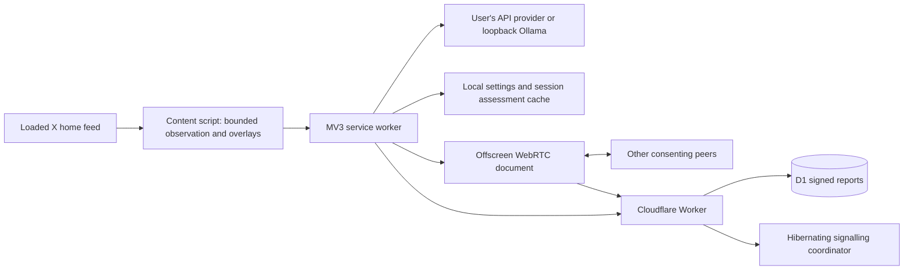

# Architecture

## Critical paths

Reveal is a synchronous local DOM change; it never waits for a model, network request or database. The community badge remains. Personal reveal state survives card recycling within the page, bounded to 1,000 IDs. New full-page navigations may apply the filter again.

Loaded cards are observed up to two viewport heights ahead. The queue is bounded to 48 pending jobs, and only one inference batch of at most four posts runs at a time. A checking cover lasts at most one second. Later results on a visible card add a warning without hiding text; ahead-of-view results can still apply the chosen blur. Content is blurred/inert without collapsing its native subtree. An additional control strip occupies space above it, so the extension does add a small amount of card height.

The main-world metadata hook observes only the site's normal HomeTimeline/HomeLatestTimeline responses and emits bounded public/author hints. The isolated adapter combines them with the visible profile link and exact post URL. The service worker checks the sender, route and message schema again. Metadata is a compatibility hint, not authenticated proof against a compromised page.

## Storage boundaries

| Storage | Data |
| --- | --- |
| Chrome local, trusted contexts | Settings, endpoint-specific keys, signing identity, revision counter, up to 1,000 corrections |
| Chrome session | Up to 500 model assessments keyed by a hash of exact input, model, prompt and preferences |
| In-memory work queue | Bounded post text, eligibility, current requests; no disk persistence |
| IndexedDB | Up to 20 MB signed reports, byte counters, assigned buckets and sync cursors |
| D1 | Latest signed revision per publisher/tweet plus bucket, sequence and bounded capacity count |
| Durable Object socket attachments | Ephemeral peer ID, buckets and signalling rate counters |

## Failure behaviour

Unsupported X layout or missing ownership/public metadata → no sharing and no remote AI for that post. Protected/own posts positively identified → no processing. Model malformed, slow, unavailable or uncertain → visible/unreviewed. Missing media/thread context → no automatic category. Relay unavailable or full → personal AI remains usable. WebRTC blocked → HTTPS primary lookup. Seeding disabled → close offscreen context. Credentials and post text never enter the relay protocol.

## Deliberate preview limits

No image/video analysis, native installer, mobile support, automatic reputation scheme, paid TURN or account scraping. No generic provider OAuth: only OpenRouter PKCE plus explicit API keys. No claim that a tiny model can reliably infer intent. The CLI evaluation harness exists so model choices can be measured before making that promise.
